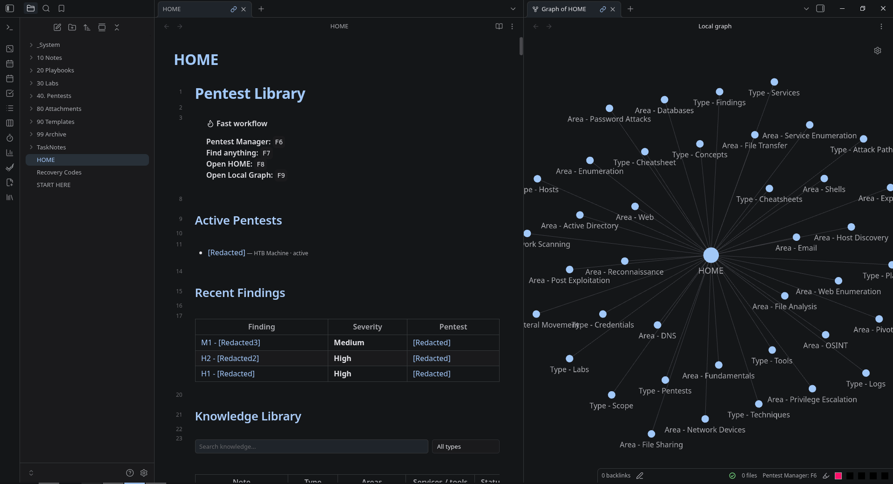
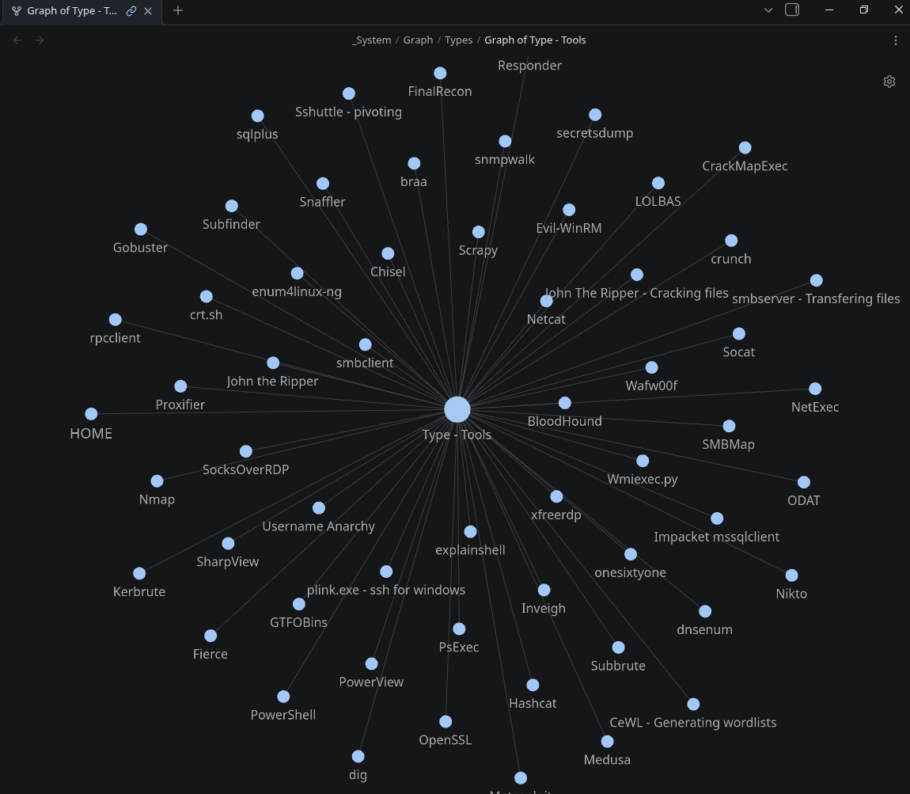
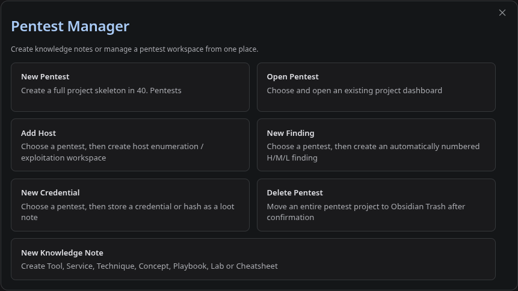

# 0xko1.sh Vault

An empty Obsidian starter vault for pentesting, offensive-security knowledge, and structured assessment workspaces.

The repository includes the custom **Pentest Note Manager** plugin, templates, hotkeys, HOME dashboard, and safe starter structure. It does **not** include personal notes, credentials, private lab history, pentest evidence, attachments, or real engagement data.

> **Pentest Note Manager:** `v3.1.4`

## Features

## HOME Dashboard

`HOME.md` is the central vault dashboard.



It provides:

- **Active Pentests**
- **Recent Findings**
- **Knowledge Library** with free-text search and type filtering
- **Recently modified knowledge**
- generated **Graph entry points**

The Knowledge Library table exposes note name, type, areas, services/tools, and status.

### Local Graph

Press `F9` to open the Local Graph for the current note.

Pentest Note Manager automatically creates relationships between notes using metadata such as type, areas, services, tools, platforms, pentest, host, and explicit related links. Generated Type and Area hubs make it easy to explore the vault visually and move between related knowledge.



### Pentest Manager

Press `F6` to open the main manager.



Available actions:

| Action | Purpose |
|---|---|
| **New Pentest** | Create a complete assessment workspace |
| **Open Pentest** | Open an existing pentest dashboard |
| **Add Host** | Add a numbered host workspace to a selected pentest |
| **New Finding** | Create an automatically numbered High / Medium / Low finding |
| **New Credential** | Store a credential or hash as a separate loot note |
| **Delete Pentest** | Move a project to Obsidian Trash after exact-name confirmation |
| **New Knowledge Note** | Create a reusable Tool, Service, Technique, Concept, Playbook, Lab, or Cheatsheet |

### Hotkeys

| Key | Action |
|---|---|
| `F6` | Pentest Manager |
| `F7` | Find anything |
| `F8` | Open HOME |
| `F9` | Open Local Graph |
| `Ctrl/Cmd + Shift + Enter` | Pentest Manager |
| `Ctrl/Cmd + Shift + O` | Find anything |

## Knowledge Library

Reusable knowledge is stored in:

```text
10 Notes/
20 Playbooks/
30 Labs/
```

`F6 → New Knowledge Note` supports:

- Tool
- Service
- Technique
- Concept
- Playbook
- Lab
- Cheatsheet

Plugin-created knowledge notes use structured frontmatter such as:

```yaml
pnm_managed: true
type:
status:
areas:
services:
platforms:
tools:
related:
aliases:
ports:
```

### Automatic relations

The plugin builds relations from note metadata.

Managed connection blocks can link to:

- the current pentest
- associated hosts
- tools
- services
- explicitly related notes
- generated Type and Area graph hubs

The **Related knowledge** view also scores shared areas, services, tools, platforms, and same-pentest / same-host relationships to surface useful nearby notes.

Generated graph hubs are stored under:

```text
_System/Graph/
├── Areas/
└── Types/
```

### Existing-note safety

The plugin is conservative with older notes.

For legacy files in `10 Notes`, `20 Playbooks`, and `30 Labs`:

- notes that already contain the `PNM-CONNECTIONS` markers may have only that managed block refreshed;
- handwritten content and frontmatter outside that block are not rewritten by relation sync;
- legacy notes without the markers are indexed for search and relations, but are not automatically rewritten.

Managed block markers:

```text
<!-- PNM-CONNECTIONS-START -->
...
<!-- PNM-CONNECTIONS-END -->
```


## Pentest Workspaces

Pentests are created under:

```text
40. Pentests/
```

Supported project types:

- HTB Machine
- Exam
- Client Assessment
- Lab / Range
- Other

The creation dialog accepts a project name plus optional target/range, platform/context, and initial objective.

For **HTB Machine**, supplying a target/IP automatically creates the first host workspace.

### Generated structure

```text
40. Pentests/
└── Example/
    ├── Dashboard.md
    ├── 1. Scope/
    │   └── Scope.md
    ├── 2. Logs/
    │   └── Activity Log.md
    ├── 3. Loot/
    │   ├── 1. Plain-Text/
    │   └── 2. Hashes/
    ├── 4. Hosts/
    ├── 5. Web/
    │   └── 1. Scans/
    ├── 7. AD/
    │   └── 1. Scans/
    ├── 8. Attack Path/
    │   └── Attack Path.md
    ├── 9. Findings/
    │   ├── 1. High/
    │   ├── 2. Medium/
    │   └── 3. Low/
    ├── 10. Notes/
    ├── 11. Files/
    │   ├── 1. Hashes/
    │   └── 2. Content/
    ├── 12. Payloads/
    │   ├── 1. Hashes/
    │   └── 2. Content/
    ├── 13. Diagrams/
    └── 14. Screenshots/
```

The skeleton is intentionally generic; engagement-specific material is added only when needed.

## Hosts

Use `F6 → Add Host`.

The plugin asks which pentest the host belongs to and collects:

- name / hostname
- IP address
- OS
- role

Hosts are numbered automatically:

```text
4. Hosts/
└── 1. WEB01 - 10.10.10.20/
    ├── Host.md
    ├── 1. Enumeration/
    ├── 2. Exploitation/
    └── 3. Post-Exploitation/
```

`Host.md` is linked back to its pentest through frontmatter and managed connections.

## Findings

Use `F6 → New Finding`.

The pentest is selected explicitly before the finding is created. If the currently open note belongs to a pentest, that project is prioritized in the selector as `Current`.

Supported severities and automatic IDs:

```text
High    → H1, H2, H3...
Medium  → M1, M2, M3...
Low     → L1, L2, L3...
```

Numbering is calculated independently inside each pentest and severity folder.

The finding dialog supports:

- title
- severity
- affected host or Project-wide scope
- CWE
- CVSS 3.1 score
- services
- tools

The included finding template contains sections for:

- Description / Root Cause
- Security Impact
- Affected Asset
- Evidence
- Reproduction / Commands
- Remediation
- External References
- Related knowledge

## Credentials and Loot

Use `F6 → New Credential`.

Supported types:

```text
Plain-text credential
Hash
```

Credential notes can record:

- username / account
- password or hash
- domain
- host
- service
- source

Storage is separated automatically:

```text
3. Loot/
├── 1. Plain-Text/
└── 2. Hashes/
```

Each credential is a separate Markdown note.

The secret itself is stored in the **note body**, not in frontmatter.

## Find Anything

Press `F7` to search indexed:

```text
knowledge notes
pentests
hosts
findings
credentials / loot
```

Search result text can include type, severity, pentest, aliases, areas, services, tools, and platforms.

## Delete Pentest

`F6 → Delete Pentest` is guarded by explicit confirmation.

The workflow requires selecting the project and typing its exact name. The entire pentest folder is then moved through the **Obsidian Trash API**, following the vault's Obsidian deletion settings.

Knowledge notes outside the project are not deleted.

## Templates

Templates are stored in:

```text
90 Templates/
```

Included templates:

```text
Tool
Service
Technique
Concept
Playbook
Lab
Cheatsheet
Pentest Dashboard
Pentest Scope
Pentest Log
Pentest Host
Attack Path
Finding
Credential
```

The visible template content can be customized. Keep the `PNM-CONNECTIONS` markers if you want automatic managed connections to remain available.

## Vault Structure

```text
.
├── _System/
│   └── Graph/
│       ├── Areas/
│       └── Types/
├── 10 Notes/
├── 20 Playbooks/
├── 30 Labs/
├── 40. Pentests/
├── 80 Attachments/
├── 90 Templates/
├── 99 Archive/
├── assets/
│   └── screenshots/
├── .obsidian/
│   └── plugins/
│       └── pentest-note-manager/
├── HOME.md
├── START HERE.md
├── CHANGELOG.md
└── README.md
```

## Quick Start

```bash
git clone https://github.com/0xko1-git/0xko1.sh-vault.git
cd 0xko1.sh-vault
```

Then open the repository root as an Obsidian vault.

If Obsidian starts in Restricted Mode, enable Community Plugins and make sure **Pentest Note Manager** is enabled. Open `START HERE.md` or press `F6`.

The custom plugin is already bundled under:

```text
.obsidian/plugins/pentest-note-manager/
```

## Configuration

Pentest Note Manager exposes settings for:

- Knowledge notes folder
- Playbooks folder
- Labs folder
- Pentests folder
- Templates folder
- Automatic graph folder
- HOME file

Default paths are already configured for this starter vault.

## Theme Compatibility

The plugin uses Obsidian semantic CSS variables rather than a fixed color palette, so the interface follows the active Obsidian theme.

## Public Repository Safety

This repository is an **empty starter**, not a place to publish live engagement data.

The included `.gitignore` excludes the contents of:

```text
40. Pentests/
80 Attachments/
99 Archive/
.trash/
```

It also excludes Obsidian session/cache files, Pentest Note Manager backups, and downloaded third-party community plugins.

If you intentionally want to version real engagement data in a **private** repository, review and adjust `.gitignore` first.

## Requirements

- Obsidian `1.5.0+`
- Community Plugins enabled
- Pentest Note Manager enabled

No external database or backend is required. The vault operates on local Markdown files and Obsidian metadata.

## Security

A real working vault can contain credentials, hashes, target information, screenshots, exploitation evidence, and client data.

Treat working pentest vaults as sensitive and do not publish live assessment data to a public repository.

## License

See [`LICENSE`](LICENSE).
